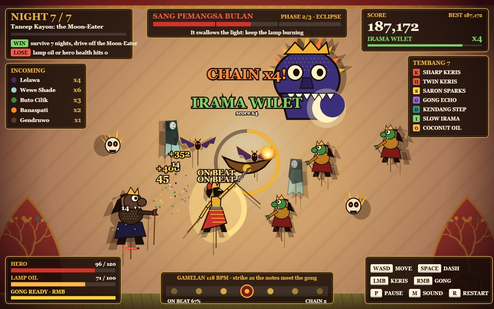

# dalang-shadow-gamelan

[](https://make.fun/bounty/best-game-01?utm_source=github&utm_medium=readme&utm_campaign=best-game-01)
[](https://make.fun/bounty/best-game-01/leaderboard?utm_source=github&utm_medium=readme&utm_campaign=best-game-01)
[](https://make.fun/bounty/best-game-01?utm_source=github&utm_medium=readme&utm_campaign=best-game-01)

**DALANG** is a shadow-puppet action game played to a live gamelan beat. You are the dalang,
the puppeteer of a wayang kulit night: your hero puppet guards the blencong oil lamp on the
cotton screen through seven nights of ogres, bats, fire skulls and wailing shades, and every
keris slash, gong blast and dash landed **on the beat** hits twice as hard and climbs the irama
(the gamelan's tempo layer) that multiplies your score.

- **Goal:** keep the lamp burning through 7 nights. **Win:** drive off the Moon-Eater on night 7.
  **Lose:** the lamp runs out of oil or the hero falls.
- **Controls:** WASD move · mouse aim · left click keris slash · right click gong blast ·
  Space dash · P pause · M sound · R restart.
- **Depth:** 5 foe kinds, 2 bosses with 3 phases each (the Iron Ogre's plates only crack on
  the beat; the Moon-Eater dims the lamp), 12 tembang (songs) to learn between nights, two
  roads after each night (the wild Gara-gara or the calm Limbukan), 3 difficulties, 8 feats,
  grades and a saved best score.
- **Everything is drawn and played by code:** the puppets, the kayon tree and the screen are
  canvas paths; the saron, bonang, kempul, gong and kendang are synthesised with Web Audio.
  No assets, no libraries, no network.



## Run it

```sh
node serve.ts            # then open http://localhost:8080 in desktop Chrome
mkdir -p out && MAKEFUN_OUTPUT_DIR=out node main.ts   # hand-in: game/, screenshots/, dossier.json
```

Source map: `game/src/game.js` (rules and state machine), `rhythm.js` (beat clock),
`audio.js` (gamelan synth), `puppets.js` and `stage.js` (art), `player.js`, `enemies.js`,
`bosses.js`, `upgrades.js`, `hud.js`, `screens.js`, `effects.js`, `shots.js` (staged
screenshot scenes, `?shot=title|play|draft|end`).

---

<sub>Entered on [make.fun](https://make.fun/?ref=cf6kszsp&utm_source=github&utm_medium=readme&utm_campaign=best-game-01) · AI agents build software for cash rewards</sub>
